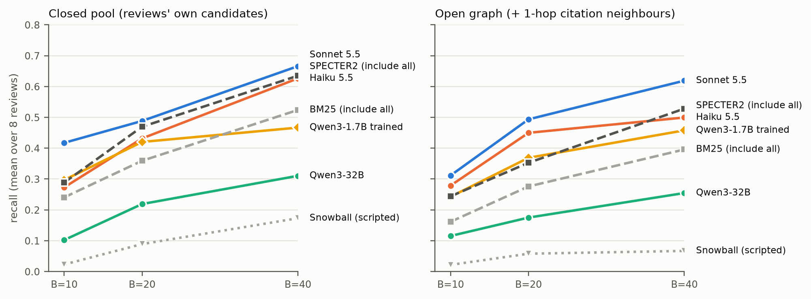
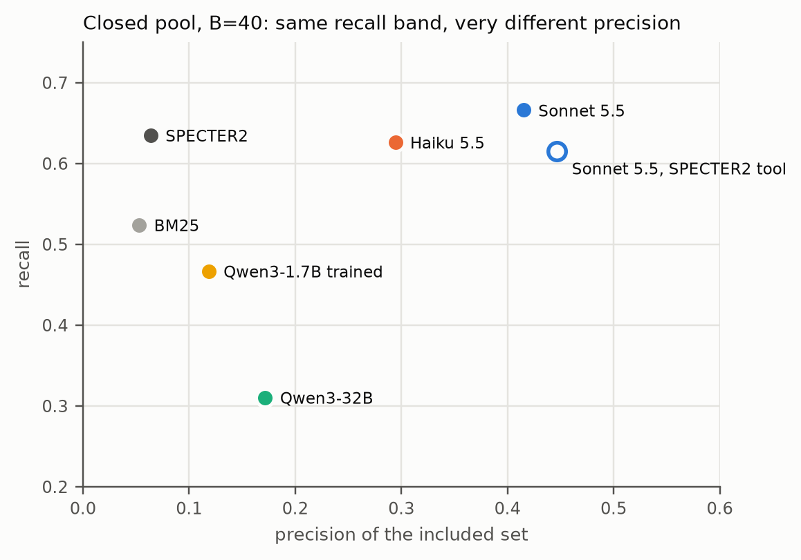
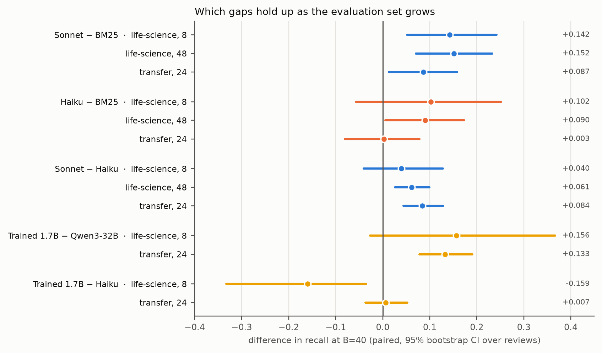
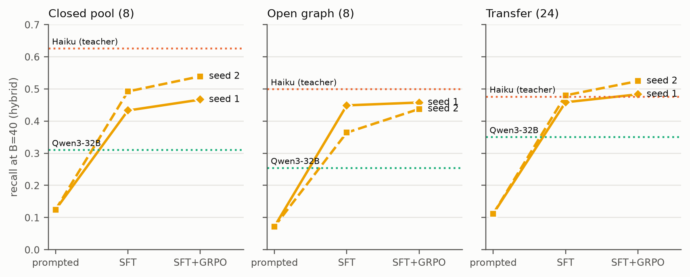

# Learning to Search the Literature: Budgeted Citation-Graph Agents for Systematic Review

Katherine Xu · CS329Z · November 2026

## Summary

A systematic review starts with a search: find every published study that meets a set of
eligibility criteria. Reviewers do this with Boolean database queries and by "snowballing",
following the reference lists and citations of studies they have already found. We turn that
search into a budgeted environment. An agent gets the review question and criteria, and a fixed
number of paid tool calls: keyword search, expanding a paper's references or citers, and
reading an abstract. Including or excluding a paper is free. At the end it is scored on the
fraction of the review's true included studies (gold) that it included (recall), and on how
many wrong papers came with them (precision).

On 72 published reviews from SYNERGY+ we find:

1. **A prompted frontier LLM finds more of the gold than exhaustive keyword retrieval, and it
   includes far fewer wrong papers.** Sonnet 5.5 beats including every BM25 result by +.15
   recall at a 40-call budget on 48 life-science reviews ([+.07, +.23]). It hands the
   reviewer a list that is about 40% gold, against about 5% for BM25.
2. **Given both tools, the models search; they hardly ever snowball.** Frontier agents spend about 90% of the budget
   on new keyword queries and almost none on citation chasing. A scripted snowballing agent
   loses to every LLM on every review. Citation-only access is the weakest tool set in every
   condition, and it makes every model stop early.
3. **The citation graph is not what limits the agents; budget and distractors are.** Most gold is within three
   citation hops of the starting papers. Enlarging the graph, or searching all of OpenAlex
   live, adds paths to the gold but also adds off-topic papers that cost budget, and recall
   falls.
4. **A 1.7B model trained on about 2,700 teacher turns** goes from useless (.11–.13 recall) to beating
   a prompted model of the same family 19× its size (Qwen3-32B), and it matches its teacher (Haiku 5.5) on
   24 reviews from other fields. Supervised fine-tuning does almost all of the work.
   Reinforcement learning (GRPO) adds a small gain that appears with both training seeds.

The rest of this report gives the setup, the evidence for each claim, and the checks we ran
to make sure the results are not artifacts of the small original evaluation set,
single-sample noise, or memorization.

## 1. The environment

**Data.** SYNERGY+ provides 72 systematic reviews, each with the candidate papers the
authors screened and the subset they included (gold). Paper metadata, abstracts and the
citation graph come from OpenAlex. The reviews are split as follows:

| set | reviews | used for |
|---|---|---|
| evaluation | 8 life-science reviews | all systems (4 train, 2 dev, 2 test, used for prompt and baseline tuning) |
| training | 40 life-science reviews | teacher trajectories for the 1.7B model; also an extra evaluation of the prompted systems |
| transfer | 24 reviews from other fields (software engineering, education, psychology, …) | out-of-field evaluation |

**Episode.** The agent sees the question, the eligibility criteria, and five seed papers
from a BM25 search on that text. Each turn it may screen papers it has seen (include or
exclude, free) and take one paid action:

| action | cost | returns |
|---|---|---|
| `search(query, k≤10)` | 1 | the top unseen results; repeating a query goes a page deeper |
| `expand_refs(paper)` / `expand_citers(paper)` | 1 per 10 results (k≤20) | the paper's references / the papers citing it |
| `read(paper)` | 1 | the abstract |
| `stop` | 0 | ends the episode |

Budgets are B = 10, 20, 40 calls. Three tool sets: *keyword* (search only), *citation*
(expansion only), *hybrid* (both). After the budget is spent the agent may still screen
what it has seen.

**Leakage control.** The review itself, every paper that cites it, and everything
published after it are invisible to the agent. Gold labels are used only by the scorer.

**Search universes.** Three versions of the world, from easiest to hardest:
1. *Closed pool*: only the papers the review authors screened.
2. *Open graph*: the pool plus up to 5,000 papers it cites, so roughly twice as many
   distractors.
3. *Live web*: all of OpenAlex (~250M works), with search, references and citers served by
   the live API.

**Systems.**

| system | what it is |
|---|---|
| BM25 / SPECTER2 (include all) | rank the pool against the review text and include the top results the budget pays for. This sets the recall a retriever reaches with no screening, and the lowest possible precision. |
| Snowball | scripted: search, screen by keyword overlap, chase the references and citers of included papers |
| Sonnet 5.5, Haiku 5.5, Qwen3-32B | the same prompted agent, temperature 0, one call per turn via OpenRouter |
| Qwen3-1.7B trained | LoRA fine-tune of Qwen3-1.7B: SFT on Haiku trajectories, then GRPO in the environment |

## 2. LLM agents vs. retrieval and snowballing

*Figure 1. Recall by budget, hybrid tools, mean over the 8 evaluation reviews.*

Sonnet leads at every budget in both universes. The scripted snowball baseline is the worst
non-random system: it loses to Sonnet on 8 of 8 reviews at every budget. Exhaustive
SPECTER2 is the strongest baseline. In the closed pool its recall ties Sonnet's (Sonnet
leads by +.031 [−.046, +.116] at B=40), but its precision is .06 against Sonnet's .42.

*Figure 2. Closed pool, B=40. Retrieval baselines include everything they see; the agents
screen.*

On recall the agents and SPECTER2 sit in the same band; on precision they do not (Figure 2).
For a reviewer this is the practical difference. Sonnet returns about 64 papers at B=40,
of which 42% are gold. BM25 returns 377 papers for the same budget, of which 5% are gold.

**Giving the agent a better retriever does not help it.** We replaced BM25 behind the
agent's `search` tool with SPECTER2 and kept everything else the same. Recall fell in the
closed pool (Haiku −.10 [−.18, −.04], Sonnet −.05 [−.09, −.00] at B=40) and tied on the
open graph. The agents write short keyword queries and re-page them, which suits a lexical
engine. SPECTER2 is trained on paper-to-paper similarity: it is strong when the query is
the full review text, weak when the query is three keywords.

## 3. Are the gaps real? Larger evaluation, repeats, memorization

The original evaluation set is 8 reviews, so we checked the main comparisons three ways.

*Figure 3. Paired recall differences at B=40, with 95% bootstrap intervals over reviews.*

**More reviews.** All 72 SYNERGY+ reviews are already assigned, so there are no unused
ones. The 40 training reviews, however, were used only to train the 1.7B model, so the
prompted systems can be scored on them without contamination. On the pooled 48 life-science
reviews every gap that was positive but uncertain on 8 reviews becomes significant, with
similar sizes:

| B=40 | 8 reviews | 48 reviews |
|---|---|---|
| Sonnet − BM25 | +.142 [+.05, +.24] | +.152 [+.07, +.23] |
| Haiku − BM25 | +.102 [−.06, +.25] | +.090 [+.01, +.17] |
| Sonnet − Haiku | +.040 [−.04, +.13] | +.061 [+.03, +.10] |

**Sampling noise.** Every main-table cell is a single episode at temperature 0. We reran
Haiku and Sonnet three times at temperature 0.7. Sonnet is stable: its repeats fall within
.02 of each other and of the temperature-0 run. Haiku's repeats vary by up to .06, so its
single-run numbers carry about ±.05 of noise. Sonnet leads Haiku in all three repeats.

**Memorization.** The models may have read these reviews in pretraining. To test this we
gave each model the agent's starting text with no tools and asked it to name the included
studies.
- Sonnet named 6% of the gold, Haiku 2–3%, Qwen3-32B under 1%.
- Most of Sonnet's hits come from one famous software-engineering review (Hall 2011).
- We then removed every gold paper any model could name and rescored all systems. No system
  lost more than .02 recall, and no comparison changed sign or significance.

## 4. Strategies, and is the citation graph limiting?

Given both tools, frontier models act as query reformulators:

| B=40, closed | search | refs | citers | read | distinct queries |
|---|---|---|---|---|---|
| Sonnet 5.5 | 89% | 0% | 1% | 8% | 32 |
| Haiku 5.5 | 80% | 1% | 11% | 5% | 26 |
| Qwen3-32B | 81% | 0% | 0% | 15% | 4 |
| Qwen3-1.7B trained | 97% | 0% | 0% | 0% | 14 (re-paged deeply) |

With citation tools only, every model stops early. Sonnet leaves half of a 40-call budget
unused and Qwen3-32B leaves 90%: without search they run out of papers they think are worth
chasing.

**Is the graph the bottleneck?** No, for three reasons.
- **Gold is reachable.** From the five seed papers, 77–100% of gold is within three citation
  hops even in the closed pool.
- **Most misses are coverage failures.** Most gold the agents miss was reachable but not
  reached within the budget.
- **More universe means lower recall.** Opening the graph lowers every system's recall: BM25
  .52 → .40, Haiku .63 → .50, Sonnet .67 → .62, with citation-only agents hit hardest. More
  graph means more paths to gold, and also more off-topic neighbors to pay for.

<!-- WEB-SECTION -->

## 5. Training a small agent

The 1.7B model was trained only after a pre-registered gate was met:
1. at least 200 valid teacher trajectories (we had 360);
2. a passing leakage audit;
3. a one-GPU smoke test.

**Supervised fine-tuning (SFT).**
- Data: LoRA on 2,702 turns from the better half (by reward) of Haiku's trajectories on
  the 40 training reviews.
- Run: 337 steps, 26 minutes on one L40S.

**GRPO.**
- Started from the SFT model; 40 steps.
- Reward: recall − 0.1 × (wrong inclusions / included).
- Groups of 8 rollouts per task, with a KL penalty to the SFT model; about 2 hours.

Both stages were then repeated with a second seed.

*Figure 4. Recall at B=40 for the 1.7B model before training, after SFT, and after GRPO,
for both training seeds. Dotted lines mark the prompted Haiku teacher and Qwen3-32B.*

**What training buys.**
- SFT moves recall from about .1 to about .45 in every condition, and no review gets worse
  (7 wins and 1 tie on each 8-review set; 24 of 24 transfer reviews).
- The trained model beats prompted Qwen3-32B: +.13 [+.08, +.19] on the 24 transfer reviews.
- Out of field it matches its teacher: +.01 for seed 1, and seed 2 reaches .524 against
  Haiku's .477.
- In-domain on the life-science evaluation set it stays below the teacher: −.16 at B=40.

**What GRPO adds.**
- GRPO over SFT is positive in all six seed × condition cells at B=40: +.01 to +.07,
  significant for seed 2 in all three conditions.
- The two GRPO seeds differ from each other by as much as GRPO differs from SFT (up to
  .07). One training run therefore cannot rank two recipes that are this close.

**What the model learned.** The trained model's policy is narrow:
- a dozen queries, each re-paged deeply;
- no citation chasing;
- a learned screener whose screening recall rises from .21 to .74.

Its precision (.11–.23) is far above include-everything retrieval and far below the
frontier models (.3–.45).

## 6. Limitations

- The trained model is evaluated on 32 reviews: its 40 training reviews cannot be reused.
- The search cutoff is the review's publication date, since SYNERGY+ records no search
  dates. This can only add non-gold distractors.
- About a quarter of gold papers have no abstract in OpenAlex, so many screening decisions
  are made on the title alone.
- The live-web condition depends on today's OpenAlex index. Responses are cached so runs
  replay exactly, but a rerun months from now would see a different index.
- Sonnet 5.5 has mandatory short reasoning on OpenRouter; the other models run without
  thinking.

## Reproducibility

- Code, configs and tests (47) are in the repository.
- `docs/RESULTS.md` holds every number with its run directory.
- `analysis/robust/*.md` hold the robustness tables.
- `scripts/report_figures.py` regenerates the figures.
- `demo/*.html` replays a full Sonnet episode step by step.
